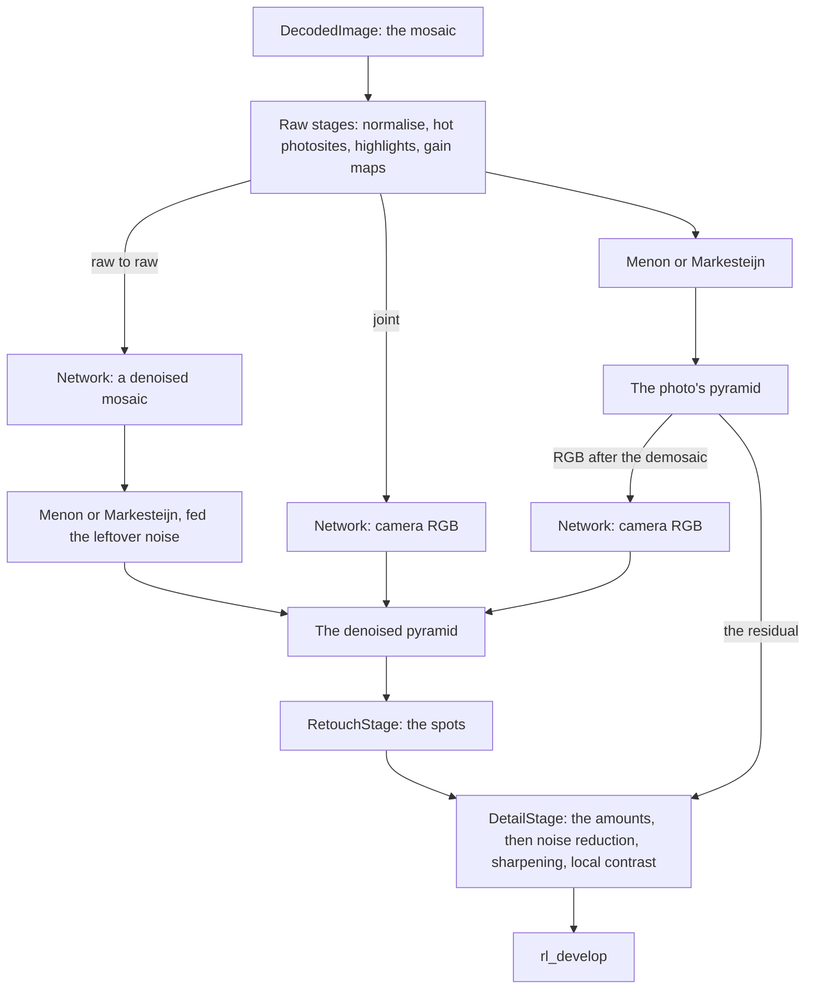

# AI Denoise: design (DN-08)

AI Denoise replaces the noise in a raw photo with a learned network's estimate of what the sensor saw, as Lightroom's Denoise does. Lightroom has kept Denoise as a cached, versioned edit in its Detail panel, with an Amount, since June 2025, rather than writing a new DNG. In Redlamp it is a stage of the edit too: computed on the Mac when an edit asks for it, kept in a cache that can be emptied and recomputed, with a Luminance and a Color amount that stay live. This document designs that stage in the engine and the app so that it can host whichever model DEC-108 chooses: AutoShade's raw denoiser v2 as an opt-in first version for Bayer if counsel clears DEC-03, Redlamp's own joint demosaic-and-denoise network (DEC-36, DN-05 to DN-07), or another. It describes the code on `main` on 1 November 2026 (process version 20, raw revision 6) and changes none of it.

It builds on [DN-17](../research/notes/DN-17-open-raw-denoisers.md) (the open models, measured), [DN-11 §6](../research/notes/DN-11-lightroom-raw-denoise.md#6-how-redlamp-can-match-or-exceed-lightroom), [A-denoise §7](../research/notes/A-denoise.md#7-product-integration), [the RawRefinery study §6](../research/rawrefinery-findings.md#6-what-to-adopt) and [the raw pipeline](../raw-pipeline.md), and links to them rather than repeating them. Names in `code` that don't exist yet are introduced as new; every other name is read from the code.

## Summary

- **Where it goes:** a new `AIDenoiseStage`, beside `RevisionStage` and `RetouchStage`, makes a denoised pyramid of the photo and hands it out as a session that stands in for the photo for every stage after it. Mosaic models take the mosaic Redlamp's demosaic takes, after all the raw stages; a raw-to-raw model's output goes through Redlamp's demosaic, a joint model's replaces it, and an RGB model takes the demosaic's output. One contract (the input's form, the noise model's form, the tiles, the leftover noise) describes any of them, in the model's manifest.
- **The noise model** is the photo's own, from the cascade DN-01 and DN-10 built, never its ISO. The Detail panel's noise reduction then works on the noise left, so a slider at the same value removes the same share of the noise that is there.
- **Running it:** image-aligned tiles from the manifest, the visible region first at 1:1, in the background, through Core ML on the Neural Engine unless measurements say the GPU, only at tile sizes checked in float16. The runner is the existing `Inference` gate with a small tiled runner built for this stage: the part of INF-03 it needs, not an XPC service yet (INF-04).
- **Caching:** the network's result before the amounts (a float16 mosaic for raw to raw, 48 MB for 24 MP; float16 camera RGB otherwise, 144 MB), on disk in Caches, keyed by the photo's samples, the raw revision, the noise model, the model and the compute units, evicted least recently used, and recomputed when it's gone.
- **Amount:** blended in the detail stage's first pass, over the area being rendered, against the photo's own pyramid: a drag costs what a Noise Reduction slider's costs today plus at most 2 ms, and runs no network.
- **The edit:** a switch and two amounts in `values` and the model's id and version in a new `aiDenoise` field; off by default, so no edit renders differently and no process version changes.
- **Building it:** of the twelve steps to a first version, the first eleven don't depend on DEC-108 and can start now, against a small test model.

## 1. Where the stage goes

### The pipeline it joins

`SessionBuilder.build` turns a decoded raw into the photo's session when it opens. `encodeMosaic` normalises (`rl_cfa_normalize`: black, banding and the as-shot balance, with values below black kept from raw revision 3, process 16, DN-12), repairs hot photosites (`rl_cfa_repair_hot_pixels`), rebuilds clipped highlights, applies DNG gain maps, and demosaics (Menon with the dual blend on Bayer, Markesteijn on X-Trans) into level 0 of an `rgba16Float` pyramid of camera RGB balanced as shot. Every render then goes through `RedlampEngine.encodePhoto`: `RevisionStage.session(for:base:)` gives the photo or its variant at the edit's raw revision, `RetouchStage.session(for:base:commands:maps:)` bakes the spots into a copy of its pyramid, `DetailStage.process` runs noise reduction, sharpening and local contrast on the pyramid's texels, and `rl_develop` develops the result. The photo's noise model (`ImageSession.noise`, from `DecodedImage.noise(profiles:)`: the DNG's NoiseProfile, the camera's calibrated profile, or a blind estimate) sets the hot-photosite threshold and the dual blend, and `DetailStage.encodeDenoise` reads it, through `NoiseCalibration`'s tables of each à-trous scale's noise after the demosaic, to set every noise slider's threshold.

### The stage

AI Denoise is a new stage, `AIDenoiseStage`, beside `RevisionStage` and `RetouchStage`. What it makes is what the photo's session holds: a mipmapped `rgba16Float` pyramid of balanced camera RGB, here the photo denoised. It hands it out as a session that stands in for the photo for the edit, as a variant does: a new `ImageSession(denoising:pyramid:result:)`, whose `photo` and `serves(_:)` follow the session it denoises and whose `original` is itself. So `RetouchStage` copies the denoised pyramid and bakes the spots into it, content-aware fills search denoised pixels, and masks' guides, Generative Remove's crop, dust and source search, Point Color's eyedropper and the readout all see the photo the edit shows. A new engine function, `photoSession(for:base:)`, calls `RevisionStage.session(for:base:)` and then the stage, and everything that calls the first today (`encodePhoto`, `encodeRawClipping`, Auto, Point Color, masks, retouching and generative fill) calls it instead. With the switch off, or both amounts at 0, the stage hands back the session it was given, so the edit renders exactly as it does today.

The denoised session keeps the photo's maps (the analysis copy, Dehaze's haze maps, the tone and Clarity bases, the glow sources). They're made from pyramid levels where the noise is averaged away, so turning AI Denoise on doesn't move Auto, Dehaze or Clarity, and costs no new maps; a retouched copy still makes its own, as `RetouchStage.Maps` does now.

### Three shapes of model



- **Raw to raw** (AutoShade v2, Buades 2026, PMRID; DN-07 as first planned): the network takes the mosaic the demosaic would take and returns it denoised; Redlamp's own demosaic then makes level 0, its dual blend fed the network's leftover noise rather than the photo's, so it stays Menon nearly everywhere ("without noise every site counts as detail", as `encodeMenon` puts it).
- **Joint** (Redlamp's own under DEC-36, RawForge's JDD, Starfish): the network takes the same mosaic and returns camera RGB at full resolution, which becomes level 0 in place of the demosaic's. The same model with its noise input at zero is Raw Details (DEC-36), which the stage would host with no new machinery.
- **RGB after the demosaic** (RawForge's X-Trans models, which follow LibRaw's Markesteijn): the network takes level 0 of the photo's own pyramid, made by CAM-07's port of the same algorithm, and returns it denoised.

Mosaic models take their input after every raw stage, at the one point a joint model can: banding and hot photosites are fixed-pattern defects that a network trained on Poisson–Gaussian noise can't remove; the photosites highlight reconstruction rebuilt and the shading gain maps correct are what the demosaic takes, so a joint model must take them too, and giving raw-to-raw models the same input keeps one place to take it. A raw-to-raw model could instead run before highlight reconstruction, so the reconstruction fits its colour offsets on denoised rims; that is worth measuring with the first raw-to-raw model, and would add an input point to the contract, not change it. DN-13's clean-up of the mosaic, if built, runs only with AI Denoise off: the network needs the noise as the sensor made it.

From raw revision 3 the mosaic carries values below black (DN-12), and a model must take them: DN-17's harness gave them to AutoShade through its stabilising transform, and its deep-shadow cast matched Redlamp's own. At revisions 1 and 2 the input is clamped at black, as everything else at those revisions is. The stage builds its input at the edit's raw revision, from the variant's decoded image when there is one, so an older edit's AI Denoise starts from the pixels the rest of its edit renders.

Linear raws (ProRAW, the small raws), bitmaps and focus stacks have no mosaic. Only an RGB model could denoise them, and none is planned, so AI Denoise isn't offered for them in the first version.

### One model contract

Every model the stage runs is described by a new optional block in its manifest, `ModelManifest.Denoise` (`denoise` in the JSON), beside the fields every model has. The licence gate (`scripts/check-model-licenses.py`) reads the same files and needs no change.

| Part | What the manifest says | Notes |
| --- | --- | --- |
| Shape | `rawToRaw`, `joint` or `rgb` | Decides what happens to the output (§1) |
| CFAs | `bayer`, `xTrans` | The switch is unavailable on other photos, with the reason |
| Input form | `bayerPlanes`: R, G1, G2 and B at half resolution (Bayer only); `cfaPlanes`: each photosite in its colour's plane plus the three planes' masks, at full resolution, so one network takes Bayer, X-Trans and Quad Bayer (RRF §6.1); `cameraRGB`: level 0 of the photo's pyramid | Tile origins fall on multiples of the CFA's period, so every tile sees the pattern in the same phase |
| Values | Normalised (0 black, 1 white) and balanced as shot, as the demosaic takes them; or unbalanced, the stage dividing each colour by `SessionBuilder.balance` and multiplying back; an affine into the model's range | Samples beyond the range a model takes pass through unchanged: AutoShade bounds its planes at white and clips its output to [0, 1], which would cut rebuilt highlights |
| Noise | `stabilised`: the stage applies a generalised Anscombe transform with the photo's a and b per colour, times the gain maps' gain, so the network sees unit noise, and inverts it with the exact unbiased inverse (Mäkitalo and Foi 2013), optionally with a constant sigma channel; `sigmaMap`: a channel of each sample's predicted standard deviation, from a local mean; `parameters`: a and b per colour as constant channels, with the gain field | §2 |
| Output | A mosaic in the input's form (raw to raw), or camera RGB at full resolution (joint, RGB) | Checked finite, tile by tile (§3) |
| Tiles | The sizes the model was checked at, the overlap, the feather (linear or raised cosine) | §3 |
| Precision | For each tile size and compute unit it may run at, float16's agreement with float32 at three noise levels, as DN-17 §5.1 measured | The stage runs a model only where it was checked |
| Compute units | The unit to use by Mac class | §3 |
| Leftover | The share of luminance and of colour noise the network leaves, by noise level, measured on the benchmark set | §2 and §5 |
| Tested memory | `testedMemory`, as for every model | §8 |

What is particular to one model goes into its conversion, not into the stage. AutoShade's sidecar runs DRUNet twice per tile, on (R, G1, B) and (R, G2, B), and averages the two estimates of red and blue; its conversion folds both passes and the average into one Core ML model, four planes in and four out, and leaves out its noise field, which DN-17 found changes nothing when the noise model is right (within 0.05 dB). A model version names its weights and everything the stage does around them: a change to either ships as a new version, so an edit that names a version always renders the same.

## 2. The noise model

**Conditioning.** The network is told the photo's noise model, as `ImageSession.noise` holds it (balanced; unbalanced for a model that asks for it), in the form its manifest gives, with the gain maps' gain from `NoiseGain` so shaded corners count as noisier. It is never told the ISO: RawForge's TreeNet conditions on ISO, a weak proxy for noise (RRF §4.5). DN-17 gave every model Redlamp's model rather than letting it measure, because AutoShade's own estimator refused detailed crops or read the noise up to twice too high; the stage does the same.

**Where the model comes from matters.** `DecodedImage.noise(profiles:)` takes the DNG's NoiseProfile, else the camera's calibrated profile at its ISO (DN-01), else an estimate from the photo (`NoiseEstimator`). A model read too high makes the network smooth detail away. Busy scenes in lossy-compressed raws read up to 3 times too noisy before DN-10's texture-rejecting estimate, which so far exists for Bayer only, so X-Trans photos without a calibrated profile are the weakest case; DN-05's calibration frames for the first ten bodies are the cure. `DecodedImage.noise(profiles:)` should also return which of the three it used (step 6), for the stage's diagnostics and the panel's info.

**NoiseReductionApplied (DN-15).** A DNG whose tag 50935 is above 0 has had noise reduction already; Redlamp doesn't read the tag yet, and DN-15 is the row that will. Such a file's noise is far below its camera's profile, so the cascade lets the measurement win, but a NoiseProfile the file carries may still describe the noise from before the reduction, and the cascade takes a file's own profile first. For a file with the tag the stage therefore conditions on the measurement, so the network does little, as it should. The Detail panel says why ("This photo's raw data was denoised before it reached Redlamp"), and AI Denoise isn't suggested for it; a linear DNG from another denoiser has no mosaic and isn't offered it at all (§1). When Redlamp writes a DNG of its own result (the DNG bake, step 13), it sets the tag to 1 and writes the leftover noise as the NoiseProfile, so no reader, Redlamp included, denoises it again.

**What the Detail panel's sliders work on afterwards.** `DetailStage.encodeDenoise` thresholds each scale at multiples of that scale's noise, measured from the session's noise model through `NoiseCalibration`; Luminance and Color mean "remove this much of the noise that is there". After AI Denoise, what is there is the network's leftover plus the shares of the photo's noise the amounts put back (§5). The detail stage therefore scales the tables' luminance sigmas by √(r_L² + (1 − L)²) and their chroma sigmas by √(r_C² + (1 − C)²), where L and C are the amounts (0 to 1) and r_L and r_C the model's leftover at the photo's noise level, from its manifest. The generalised Anscombe transform keeps the photo's a and b, since the noise put back depends on brightness as the photo's does. Sharpening's separator (`DenoiseSettings.separator`) and process 11's ladder (`NoiseCalibration.ladderSigmas`) take the same scales, so sharpening stops treating as noise the detail the network kept. With the scales, the classical sliders need no reset when AI Denoise is turned on: Color at its default of 25 then works on colour noise that is mostly gone, and does little. `NoiseBenchmarkTests` checks that Luminance 50 removes the same share of what is left with AI Denoise at a given amount as without it on a photo with that much noise.

Generated fills and the demosaic of a denoised mosaic take the leftover alone: `encodeStoredFill` passes `original.noise` to `rl_fill_stored` today, and for a denoised session that becomes the photo's model scaled by the leftover, so a fill made with AI Denoise on carries the noise of its denoised surroundings.

## 3. Running it

### Tiles

Tiles lie on a grid fixed to the photo's photosites, not the view, so the tiles a 1:1 preview computes are the tiles an export computes and the preview is exactly what exports (A-denoise §7.3). Their size, overlap and feather are the model's: AutoShade's are 512-sample tiles of its half-resolution planes (1,024 photosites) overlapping by 32, with a linear feather, as its sidecar runs it; the last tile of a row or column moves inward to end at the photo's edge, as the sidecar's does, so every tile is the size the model was converted at. Feathered tiles are summed in float32 one band of tile rows at a time, divided by the sum of their weights, then stored in float16.

Tiled output equals untiled output only if the network looks no further than the overlap. A global pooling layer (NAFNet's simplified channel attention) or attention over a whole tile (Restormer's transposed attention, in RawForge's models) makes every output pixel depend on the whole tile, so the result changes with the tile's size and content, and a seam can show where tiles meet. The contract therefore asks for a tile-local network: at the declared overlap, tiled and untiled results differ by less than 0.001 of white over DN-17's benchmark crops, measured when the model is converted and recorded in its notes. A network with global pooling can be made local at conversion by replacing it with pooling over a fixed window (Chu et al., TLC, 2022). One that can't is run only at a single tile size on the fixed grid, so previews and exports still agree with each other, though not with an untiled run; its notes say so. Redlamp's own network (DN-07) should be local by design: no global pooling, and attention, if any, only at the coarse levels, which also keeps it within float16 (RRF §6.1).

### Compute units and float16

Core ML runs a model on the GPU or the Neural Engine, and each has its own float16 arithmetic. DN-17 found AutoShade safe on both at 256, 512 and 768-pixel tiles (79 to 83 dB from float32 on the GPU, 67 to 69 on the Neural Engine; for AutoShade a pixel of a tile is a sample of its planes), and RawForge's joint model NaN for every pixel at 768 on the GPU and correct at 512. So a model's manifest lists every tile size and compute unit it was checked at, and the stage runs it nowhere else. The check is repeated on each new macOS by `AIDenoiseModelChecks`, a suite that runs only where the model is present (`REDLAMP_DENOISE_CHECK=1`, as `FluxFillCostMeasurements` runs only with `REDLAMP_FLUX_MEASURE`): ViTMatte's version 1 showed that an update to Metal Performance Shaders Graph can break a model that worked (MSK-33). INF-02's placement check (`MLComputePlan`) runs in the conversion script.

The compute unit is chosen per Mac class from measurements (INF-02), the Neural Engine unless they say otherwise. It leaves the GPU to the editor, which renders every frame there, and uses less power. AutoShade's network took 0.26 s per 768-pixel tile on the M1 Ultra's Neural Engine and 0.17 s on its GPU through Core ML, under load. If Core ML runs a model on only one of the Ultra's two 16-core Neural Engines, as it may, the Neural Engine's time carries over to smaller Macs whose GPUs are much slower; DN-04's measurements would say. One job runs on one unit, and the unit is part of the cache's key (§4), so a change of choice never mixes results.

A tile whose output holds a NaN or an infinity fails the job: the photo renders without AI Denoise, the panel says the model failed on this photo and offers Report a Bug, and the activity log records the tile. Wrong pixels are never rendered.

A fidelity guard (DN-11 §6.3) checks every tile against its input at a sixteenth of its size, where the noise is averaged out: per camera channel, a 16 × 16 block's mean after the network may differ from its mean before by at most 6 standard errors of the noise there. A network that shifts a colour or a brightness, rather than removing noise, fails it. A failing block takes the input back, feathered over its neighbours, and the count goes into the job's diagnostics. The threshold is set on the benchmark set so that an accepted model never trips it there: it guards photos unlike anything the model was tested on.

### Scheduling

A job computes one photo's result for one model at one raw revision and noise model, in the background:

1. **The visible region first.** At 1:1 the tiles that reach the view and the detail stage's margin around it go first; when they're done the stage hands out a new session whose pyramid has them (§1), and the frame updates. A pan to an area not yet done moves its tiles to the front. At fit the whole photo is visible, so it updates once, when the job finishes.
2. **Then the rest of the photo,** handed out when the job finishes. The stage hands out a new session at most once a second, so the caches keyed by session (the detail stage's outputs, the retouched copies) render again at most that often. A Remove spot's fill searched on a partial session is searched again on the finished one, so a fill never depends on which tiles were done first, and an export, which waits for the finished result, fills as the editor shows.
3. **Exports and batch exports** queue behind the open photo's job and run at their own priority (§7).

Core ML predictions run on a task at utility priority, in batches of up to 4 tiles on Macs with 16 GB or more and one at a time on 8 GB Macs (A-denoise §7.3). The stage's Metal work (packing tiles, the stabilising transform and its inverse, the demosaic of finished regions) is encoded on the engine's render queue between frames, as stills yield to the canvas between their tiles (`yieldBetweenTiles`), so a frame never waits on it. Tiles reach Core ML and come back in IOSurface-backed float16 buffers (`MLMultiArray(pixelBuffer:shape:)`, `MLPredictionOptions.outputBackings`), which Metal reads and writes as textures, so neither side copies them. The model is compiled for this Mac once, right after its download (and again after a macOS update), and loads through `Inference.shared` when the switch is turned on or an edit with it opens; it unloads when the editor closes, after two minutes unused, or under memory pressure, as the mask models do (`unloadMaskModels`).

A job is cancelled when its photo is left, its model or the edit's raw revision changes, or the app quits (`Inference.stop(waitingAtMost:)`); it stops at its next batch. Turning the switch off doesn't cancel it: it finishes into the cache, so turning it on again is instant, unless the photo is left first. The amounts never touch the job (§5).

After each batch the job rests for `RedlampEngine.cooldown(after:thermalState:)`, as exports do: as long as it worked when the thermal state is serious, three times as long when it is critical. In Low Power Mode it runs one tile at a time and rests as at serious. An export still finishes, more slowly.

### The runner

The stage uses the existing Core ML runner, `Inference` (RedlampMasking), for every load and prediction, so the app can still stop all models before it exits. Around it the stage needs what `Inference` doesn't do: the fixed grid, priorities, cancellation per batch, the thermal rest, and the hand-over between Core ML and Metal. That is the part of INF-03's `TiledRunner` AI Denoise needs, built here, in RedlampEngine, behind a protocol, `AIDenoiseModel`, with one implementation over Core ML (`CoreMLDenoiser`, in RedlampMasking beside `ViTMatte` and `SAMSegmenter`) and one over a Metal kernel for the tests. INF-03's lanes for every model (6 to 9 weeks) aren't needed for it; SR-02's and SHP-03's heads on the same network would reuse it.

INF-04's XPC service isn't needed for the first version. Raw files are hostile input, which is why decoding runs in `RedlampDecoder.xpc`; a model is Redlamp's own file, pinned by SHA-256 in its manifest. A service would add a second process holding GPU memory and a hand-over per tile. Its argument is crashes: Metal Performance Shaders Graph aborted in 28 of 1,296 fresh loads of ViTMatte's version 1 on macOS 27, and an abort in the app ends the photographer's session. Every model runs in the app today; if crash reports show AI Denoise taking the app down, the protocol and the IOSurface buffers, which cross a process boundary without copies, let the runner move into `RedlampInference.xpc` without changing its callers.

## 4. Caching

**What is kept** is the network's result before the amounts. For a raw-to-raw model it is the denoised mosaic, one float16 per photosite: 48 MB for 24 MP. For joint and RGB models it is float16 camera RGB: 144 MB for 24 MP. The pyramid isn't kept: it's made again from the result by the demosaic, or by a copy, with its levels, in about 0.1 s. Lightroom keeps 5 to 48 MB of generated pixels per photo in its catalog or sidecars (DN-11 §6.3); Redlamp keeps nothing in the sidecar.

**Where.** In memory, the denoised session of the open photo's edits and its comparison, let go of with the photo (`keepOnly`, as the other stages do) or when the system runs short of memory (the engine's memory-pressure handler). On disk, a new `AIDenoiseCache`, an actor like `EmbeddingCache`, in `RedlampFolders.caches`'s `Denoise` folder, which macOS may purge; compressed losslessly in 1 MB blocks with Apple's Compression framework (LZFSE), each file's header holding its full key.

**Keyed by** the SHA-256 of the decoded samples (so rewriting a file's metadata, or moving it, doesn't miss), the raw revision the input was built at (the earliest that builds the same mosaic, so edits at revisions that build the same pixels share one result), the noise model's a and b per colour, the model's id and version, the compute unit, and a version of the stage's own steps, raised only by a fix for wrong pixels, so results made before the fix are made again. Hashing a 24 MP mosaic's 48 MB takes about 25 ms.

**Evicted** least recently used once the folder passes its budget, checked after each store, as `EmbeddingCache.trim` does; proposed budget: the smaller of 10 GB and 5% of the free space on the startup disk, which holds about 200 raw-to-raw or 70 joint results of 24 MP. Settings › Models shows the cache's size and a Clear button.

**When it's gone** the edit recomputes, as on its first run: interactively, the photo renders without AI Denoise until the visible region lands, with the panel's progress; an export waits for the result. Results aren't shared between Macs. A recompute on the same Mac and macOS gives the same result; after a macOS update, or on another Mac, it may differ within float16's tolerance (for AutoShade, above 67 dB from float32 on the Neural Engine and 79 on the GPU), not bit for bit.

## 5. Amount

**Where the blend happens.** In the detail stage, as its first pass: a new kernel, `rl_ai_denoise_blend`, over the work area at the work level, before noise reduction, sharpening and local contrast. It reads the denoised session's pyramid with the spots in, and the photo's own pyramid, which the denoised session holds (`denoisedFrom`). The residual r is their difference: the noise the network removed, and for a joint model the demosaic's differences too. Its luminance part is the neutral with r's Rec. 2020 luminance in the pyramid's camera RGB (`DetailStage.luma(session)`), its colour part the rest, and the pass writes denoised + (1 − L) × luminance part + (1 − C) × colour part. Both amounts at 1 is the network's result; both at 0 is the photo as without AI Denoise, which is why the stage hands back the photo itself then (§1). Amount 0 to 100 in the panel is 0 to 1 here.

**What it costs per frame.** Dragging an amount changes nothing before the detail stage: the denoised session, its retouched copy, its fills and maps and the masks' guides are all keyed by the session, which an amount doesn't change, and the network doesn't run. At 1:1 on a 2560 × 1600 view, the pass reads two `rgba16Float` texels and a coverage byte and writes one for each of about 4.5 million texels (the view with the detail stage's 64-texel margins): about 0.15 ms of GPU time on an M1 Ultra and 1.7 ms on an M1, from their memory bandwidth (estimates). Noise reduction, sharpening and local contrast then run again on the new source, as when a Noise Reduction slider moves: 9 to 10 ms at 1:1, 14 at the 95th percentile (DN-02). With both amounts at 100 and nothing else for the detail stage to do, there is no pass at all: the develop kernel reads the denoised pyramid as it reads a photo's.

**Why there.** Blending before the retouch would make each amount a new session: on a 24 MP photo, a whole-photo blend and its levels (about 0.8 GB of memory traffic) per frame, and the retouched copy, its fills and maps made again. Blending on the mosaic, as A-denoise §7.2 proposed, can't split luminance from colour. Two amounts after the network let a photographer keep grain without colour blotches (RRF §6.5), and both are live from the first frame: Lightroom's Amount can't be set before Denoise first runs, and is reset when it's applied (DN-11 §6.3).

**Spots.** Under a spot, the photo's own pixels are what the spot removed, so adding back their residual would bring a removed object back at any amount below 100. `RetouchStage` therefore makes the spots' coverage (the union of their alphas, an `r8Unorm` texture with levels) when it bakes them, and under it the blend puts back noise drawn from the photo's noise model, as `rl_fill_stored` draws it and seeded by position so every render is the same, instead of the residual, at the same amounts. A spot then matches the noise around it at any amount, and so does a generated fill (§2).

## 6. The edit

AI Denoise is a new setting, off by default. No edit made before it has it, so none renders differently, and no process version changes: `ProcessStabilityTests` needs no new references.

**In `values`**, three new parameters of the Detail panel, held by its switch (UX-30), so switching Detail off renders without AI Denoise as it renders without sharpening and noise reduction:

| Key | Range | Default | Notes |
| --- | --- | --- | --- |
| `detail.aiDenoise` | 0…1 | 0 | The switch, as `lens.profile` is Enable Profile Corrections |
| `detail.aiDenoiseLuminance` | 0…100 | 80 (proposed) | The share of the luminance noise the network removed that stays removed |
| `detail.aiDenoiseColor` | 0…100 | 100 (proposed) | The same for colour noise |

The keys follow the lens profile's (`lens.profile`, `lens.profileDistortion`), and the cases are `ParameterID.aiDenoise`, `.aiDenoiseLuminance` and `.aiDenoiseColor`.

The defaults leave a little luminance grain, which reads as natural and hides the smoothness a network gives fine texture, and remove all colour noise, which photographers rarely want to keep; DN-09's blind study should settle them.

**A new field, `aiDenoise`**, written when the switch is first turned on and kept when it's turned off, so turning it on again finds the same result:

```json
"values": { "detail.aiDenoise": 1, "detail.aiDenoiseLuminance": 70 },
"aiDenoise": { "model": "redlamp-denoise", "modelVersion": 1 }
```

`model` (the manifest's id) and `modelVersion` (an integer) are required, as a generated fill's `model` and `modelVersion` are. The object keeps keys a newer Redlamp writes (a mode for Raw Details, a head for Super Resolution), and the schema leaves it open. An edit with the switch on and no field (a pasted recipe) renders with the newest offered model that supports the photo's sensor, and the editor writes that model into the field with the edit's next change, as it gives an edit its photo's exposure anchor (`EditorModel.withPhotoAnchor`). The new type is `AIDenoiseChoice` in RedlampEngineAPI, `EditRecipe.aiDenoise`, coded under `aiDenoise`.

**The sidecar format.** `docs/recipes/sidecar-format.md` gains the field in the recipe's table, the three keys in its Parameters table, and a section, AI Denoise, beside Lens profile: what the field names, that the result is a cache and never in the package, what renders when the model isn't on the Mac, and that builds from before it keep the key and the values as unknown and render without AI Denoise, as builds from before the channel curves do. `sidecar-format.schema.json` gains them, and `SidecarSchemaTests` writes an edit with the field and checks that it validates, that its keys are all in the schema, and that the three parameters' ranges match the code. Its process-version tables don't change.

**Copy Settings, presets, versions.** A new item in the checklist's Detail group, `SettingsItem("detail.aiDenoise", "AI Denoise", [.aiDenoise, .aiDenoiseLuminance, .aiDenoiseColor], fields: [.aiDenoise])` with a new `EditField.aiDenoise`, ticked by default as Noise Reduction is. Pasting carries the model's version with the settings; on a photo the model can't take (an X-Trans photo, a Bayer-only model) the switch stays on, nothing changes in the render, and the panel offers a model that can take it. Pasting or syncing onto many photos starts nothing: each photo computes when it's opened or exported (§7). A `.redrecipe` that includes the Detail group carries the switch and the amounts as values, not the model: a recipe is a look, not an edit of one photo. Each of a photo's versions has its own field, and the stage keeps results for the versions in use, as `RevisionStage.keep(for:of:)` keeps variants.

**When the model named isn't on this Mac.** A cached result renders without the model. Otherwise, if the version is published, the panel says the edit uses it and offers its download with its size; until then the photo renders without AI Denoise, as a lens profile that isn't on the Mac leaves the photo at Default and the panel says so. A version this Redlamp doesn't know (from a newer one), or one no longer offered, renders without it, the field kept, and the panel says which. An export of such an edit asks first (§7).

**When a newer model ships.** Edits keep the version they name, so they keep rendering as they did; new edits take the newest. The panel shows that a newer version is available, and Update moves the edit to it in one History step; Photo › Update AI Denoise does it for a selection, as Update AI Masks does (INF-06). Older versions stay installed until removed: their manifests stay in the catalogue (one file per version), `ModelStore.removeOutdated` leaves the older versions of a model with a `denoise` block, and Settings › Models lists each installed version, its size and the Remove button. `ModelInfo`'s identity gains the version, so two versions are two rows.

## 7. Delivery and the app

### The model as a download

The model is an opt-in download, delivered as Segment Anything, ViTMatte and FLUX.2 [klein] are: a manifest in `packages/RedlampMasking/Resources/Models/` with every file's SHA-256, published as a prerelease on pdcgomes/redlamp by `scripts/publish-model.py` once the owner approves the upload (DEC-26), fetched into Application Support by `ModelStore` with resumed, checked files, and in the App Store build one Background Assets pack per version (INF-07). The licence gate decides who is offered it: AutoShade v2's training data includes RawNIND (CC BY-SA 4.0), so its manifest names DEC-03 and stays uncleared and unpublished (`published: false`, so it runs only on the Mac that converted it) until counsel answers; converted to float16 it is about 65 MB (the published file is 130 MB in float32). Redlamp's own network, trained on Redlamp's captures and CC0 raws, would be cleared, at about 25 MB for 10 to 15 million parameters. Until either is published, `REDLAMP_DENOISE_MODEL` points the stage at a converted model on the Mac, as `REDLAMP_GENERATIVE_MODEL` does for generative fill.

**The offer.** Turning the switch on without the model shows the offer, as Generative Remove's first use does: what AI Denoise does, that it runs on this Mac and photos are never uploaded, the model's name and size, its licence and its training data as the manifest names them, which sensors it takes ("Bayer sensors; not Fujifilm X-Trans"), and on a Mac with less memory than it was tested on, that it may be slow or not work there (`ModelInfo.untestedNote`). A third party's model carries its credit and notice (AutoShade's: "AutoShade raw denoiser v2, © 2026 skymanbp, MIT licence; fine-tuned on RawNIND, CC BY-SA 4.0"), shown in the offer, in Settings › Models and in Acknowledgements.

**Settings › Models** shows it as every model's row (`ModelsSettings`), plus the cache's size with Clear, and older installed versions with their own rows.

### The Detail panel

Lightroom's Denoise is a button that computes, then an Amount. Redlamp's is a switch with two live amounts, at the top of the Detail panel's Noise Reduction section, in both its forms (`DetailPanel` and `ReferencePanelViews.detail(model:)`):

- **AI Denoise**, a checkbox (a new `AIDenoiseToggle`, as `ProfileCorrectionsToggle` is one), with an info button that shows the model's name, version and licence, the noise model's source (the file's profile, the camera's, or measured), the compute unit, and how long the last run took on this Mac.
- **Luminance** and **Color**, its two amounts, under it, enabled while it's on. Their schema labels are "AI Denoise Luminance" and "AI Denoise Color", which History, search and Copy Settings show.
- **A status line** while it computes ("Denoising the visible area…", then "Denoising… about 6 s left"), Retry after a failure, and the reason when it can't run (the sensor, the model missing, AI-Free mode).
- **The classical sliders** below, unchanged, with the subsection's help saying that with AI Denoise on they work on the noise it leaves (§2).

The canvas shows a small progress indicator while the visible area computes. A before-and-after view whose before has AI Denoise off (`RenderRequest.comparison`) costs nothing extra, since that renders from the photo's own pyramid. A new `EditorModel+AIDenoise.swift` holds the switch's state, the offer and the progress; the engine gains `aiDenoiseAvailability()` and a stream of the job's progress, as it has `generativeFillAvailability()`. Thumbnails and previews smaller than half the photo show AI Denoise only from the cache and never start it.

### Export, batch export and the CLI

A still for export (`StillPurpose.export`) of an edit with AI Denoise waits for the photo's whole result, from the cache or from a job at export priority, then renders as now; a preview still doesn't wait. Batch export computes each photo before writing it, the next photo's network running while the current one is encoded and written. The export sheet says how many photos use AI Denoise and about how long it adds, from this Mac's last runs, and before starting, lists the photos whose model isn't on this Mac and offers the download; a photo whose model can't be had exports without it and the export's summary says so.

`redlamp render` gains `--ai-denoise [<model>]`, which turns the switch on with the newest installed model or the one named, downloading it first when it isn't there, as `redlamp mask` downloads Segment Anything; the amounts are `--set detail.aiDenoiseLuminance=…` and `--set detail.aiDenoiseColor=…`, a sidecar given with `--recipe` renders with its own model, and the render waits for the whole photo. `redlamp export` renders each edit's own setting. `redlamp bench` times the first 1:1 region and the whole photo, as two new metrics in `docs/performance/metrics.json` for `scripts/perf-record.sh`.

### Report a Bug and AI-Free mode

Report a Bug's Develop area gains a feature, `ai-denoise` ("AI Denoise"; keywords such as ai denoise, neural, smudged, plastic, waxy), in `FeedbackAreaCatalog`, and `docs/feedback/areas.json` with it (`FeedbackAreaTests`). A report about it carries the edit's field, the job's log (model, compute unit, tile size and batch, times, cache hit or miss, the fidelity guard's count, any non-finite tile) and the noise model with its source; Settings › Models' downloads stay under AI Model Downloads.

AI-Free mode (INF-10) hides AI Denoise with the other AI tools. INF-10's row says that edits holding AI masks or fills keep rendering; those are stored pixels, whereas AI Denoise would run a model every time its cache is empty. So, while AI-Free mode is on, edits with AI Denoise render without it and the panel says why; their field and amounts stay, and they render with it again when the mode is turned off. The owner decides (§10).

### The regression scenario and the tests

**The scenario**, `develop.ai-denoise` in `DevelopScenarios`, worked through the user's input: open the working photo, as the other Develop scenarios do (the test model takes a fraction of a second on it), zoom to 1:1, click AI Denoise in the Detail panel, wait for the visible area, set Luminance to 50 and Color to 0 as the other sliders are set, check that the frame changed and that the stage computed no new tile, undo back to off through History, paste the settings onto a second photo, and export it, checking that the export waited for the whole photo. It claims the new feature and the three parameters, so `RedlampAutomationTests` counts them covered. It runs with a test model, not a download, so it never skips.

**The test models** are two Core ML packages of a few kilobytes, made by a script and committed with the tests: a raw-to-raw one that averages each plane's 3 × 3 neighbourhood in the stabilised domain, and a joint one that demosaics bilinearly. They exercise the whole Core ML path (loading through `Inference`, IOSurface buffers, batches, the GPU and the CPU) with known outputs. A Metal implementation of the same protocol makes the unit tests exact and fast.

**Unit tests** (RedlampEngine, Swift Testing), new suites:

- `AIDenoiseStageTests`: tiled equals untiled for a local model; the 1:1 preview's tiles are the export's; the visible region lands first; a cancelled job stops at its next batch; a NaN tile fails the job and renders nothing wrong; the fidelity guard takes back a block a broken model shifted; edits at two raw revisions that build the same mosaic share one result.
- `AIDenoiseBlendTests`: both amounts at 100 render the network's result, both at 0 render exactly what the edit renders with the switch off, Luminance changes no colour and Color no luminance, and a removed object doesn't come back under its spot with both amounts at 10.
- `AIDenoiseCacheTests`: a result stored, read back bit for bit, evicted past the budget and recomputed; each part of the key misses when it changes.
- `NoiseBenchmarkTests`, extended (§2), and `SidecarSchemaTests`, `ModelStoreTests` and `OutdatedModelsTests` for the field, the manifest block and the kept versions.

**References.** The test models' results on the six development fixtures are recorded in `tests/golden/ai-denoise` and compared as process references are (a mean of 0.02 and a worst of 0.2 CIEDE2000, room for another GPU's rounding), so a change to the stage's own steps shows. `ProcessStabilityTests` runs unchanged and must pass unchanged: none of its edits turns AI Denoise on, and with it off the stage and the blend never run.

**Metal's validation layer** is on in every test target. The new kernels validate their inputs before any encoder opens, since a throw inside one aborts under the layer; IOSurface-backed textures are made with the usage Core ML and the kernels need. The real models' float16, tile and timing checks live in `AIDenoiseModelChecks` (§3), run where the model is present.

## 8. Budgets

Measured where the measurement exists (DN-17, on the M1 Ultra under load from other agents, so upper bounds); otherwise estimated from sizes and compute, and marked so.

| | AutoShade v2 (2,118 GFLOPs per megapixel) | Redlamp's own (at most 370, DN-17 §8) |
| --- | --- | --- |
| Network, 24 MP | 5.2 s on the GPU, 7.9 s on the Neural Engine, through Core ML (measured) | about a sixth of that (estimate) |
| First 1:1 region, a view of 2560 × 1600 pixels | 6 to 12 tiles of 512 samples, depending on where the grid falls: about 1 to 2 s on the GPU, 1.5 to 3 s on the Neural Engine, plus the decode and raw stages (0.4 to 0.8 s) when nothing is cached (estimate) | under 0.5 s (estimate) |
| Targets, model loaded, on an M1 Pro or better | first 1:1 region within 3 s, whole photo within 10 s | within 0.5 s and 3 s |
| Reopening a cached photo | read and decompress 48 MB, demosaic: about 0.2 s (estimate) | 144 MB, copy: about 0.2 s (estimate) |
| Dragging an amount | a Noise Reduction drag at 1:1 (9 to 14 ms) plus under 2 ms | the same |

Compiling a model for the Neural Engine can take seconds; it is done once, after the download, and kept (`CompiledModels`), so it isn't in these times (§3). A whole 24 MP photo on an 8 GB M1 hasn't been measured; if the Neural Engine runs AutoShade as fast there as on the Ultra, about 8 s.

**Memory**, for a 24 MP photo (61 MP in brackets), beyond what the open photo holds today:

- **At rest:** the denoised pyramid, 8 bytes a pixel and a third more for its levels: 256 MB (640 MB). With spots, their coverage: 32 MB (80 MB).
- **While computing**, on a Mac with 16 GB or more, AutoShade in batches of 4 tiles of 512 samples: the input mosaic (96 MB in float32), the band being summed, the model's weights (65 MB), the decoded samples (48 MB) and Core ML's activations (DRUNet at 512 samples holds about 150 to 250 MB per tile in flight): about 1.1 GB more for the job, so about 1.4 GB above the open photo in all (estimate; DN-17 measured a 2.0 GB peak for the whole PyTorch process).
- **On an 8 GB Mac:** one tile at a time at 256 samples: about 0.6 GB above the open photo while computing (estimate). The manifest's `testedMemory` says the least the model was tried on, and the offer says so on smaller Macs (RM-15's rule).

**Disk:** per photo, 48 MB (120 MB) for a raw-to-raw result and 144 MB (360 MB) for joint or RGB, before compression; the cache's budget bounds the total (§4).

## 9. What it would take to build

S is up to a week, M one to three weeks, L more. Steps 1 to 11 don't depend on DEC-108: they run against the test models, and AutoShade converted on a development Mac (not published) as an evaluation model can stand in for a real one. Together they come to more than DN-08's 4 to 5 engineer-weeks, because they take in the part of INF-03 the stage needs and the app's side.

| # | Step | Delivers | Files | Size | Needs DEC-108 |
| --- | --- | --- | --- | --- | --- |
| 1 | Split the raw stages from the demosaic | `encodeMosaic` as two functions, the raw stages into a mosaic texture and the demosaic from one, callable apart; no output changes (`ProcessStabilityTests`, `CameraGoldenTests`) | `SessionBuilder.swift`, `docs/raw-pipeline.md` §7 | S | No |
| 2 | The edit | The three parameters, `AIDenoiseChoice` and `EditRecipe.aiDenoise`, `EditField.aiDenoise`, the checklist item, `SwitchablePanel.detail` holding them, recipes carrying the values; the sidecar format, its schema and their tests; renders nothing yet | `ParameterID.swift`, `ParameterSpec.swift`, `EditRecipe.swift`, `SettingsSelection.swift`, `PanelSwitches.swift`, `Recipe.swift`, `docs/recipes/sidecar-format.md` and `.schema.json`, `SidecarSchemaTests.swift` | S | No |
| 3 | The contract | `ModelManifest.Denoise`; the store keeping older versions of denoise models; `ModelInfo` by version | `ModelManifest.swift`, `ModelStore.swift`, `Models.swift`, `ModelStoreTests.swift`, `OutdatedModelsTests.swift` | S | No |
| 4 | The runner and the test models | `AIDenoiseModel`, `CoreMLDenoiser` through `Inference` with IOSurface buffers and batches, the Metal test implementation, the two test models and the script that makes them | `RedlampMasking/Sources/CoreMLDenoiser.swift`, a new `AIDenoiseModel.swift`, test resources, `research/prototypes/raw_denoise/make_test_models.py` | M | No |
| 5 | Tiles and jobs | The fixed grid, feathered summing, the visible region first, cancellation, the thermal rest and Low Power Mode; packing, the stabilising transform and the exact unbiased inverse (a table DN-16 can adopt for noise reduction later), the non-finite check and the fidelity guard | `AIDenoiseStage.swift`, `AIDenoiseJob.swift`, `Shaders/AIDenoise.metal`, `KernelParams.swift`, `KernelLibrary` | M | No |
| 6 | The denoised session | `ImageSession(denoising:pyramid:result:)`, `photoSession(for:base:)` in every reader, the raw-to-raw path (denoised mosaic through the demosaic) and the joint path, sessions handed out as tiles land, the leftover for fills and the demosaic, the noise model's source; a section in the raw-pipeline paper | `ImageSession.swift`, `DecodedImage.swift`, `RedlampEngine.swift`, `RedlampEngine+Retouch.swift`, `RedlampEngine+PointColor.swift`, `RedlampEngine+Masks.swift`, `RedlampEngine+GenerativeFill.swift`, `RetouchStage.swift`, `docs/raw-pipeline.md` | M | No |
| 7 | The amounts | `rl_ai_denoise_blend` as the detail stage's first pass, the noise scales in noise reduction, the separator and the ladder, the spots' coverage and the noise put back under it | `DetailStage.swift`, `DetailStage+Ladder.swift`, `DetailStage+Sharpen.swift`, `Denoise.metal`, `RetouchStage.swift`, `Retouch.metal`, `Fill.metal`, `NoiseBenchmarkTests.swift` | M | No |
| 8 | The cache | `AIDenoiseCache` on disk and the sessions kept in memory, the key, eviction, Clear | `AIDenoiseCache.swift`, `RedlampEngine.swift` | S | No |
| 9 | The app | `AIDenoiseToggle` and the amounts in both forms of the Detail panel, the offer, progress on the panel and the canvas, Settings › Models' versions and cache, Update AI Denoise, Report a Bug's feature and diagnostics, AI-Free mode's hook once INF-10 lands | `ReferencePanels.swift`, `ReferencePanelViews.swift`, `EditorModel+AIDenoise.swift`, `ModelsSettings.swift`, `FeedbackAreaCatalog.swift`, `docs/feedback/areas.json`, `EditingEngine.swift` | M | Wording of the offer and credit only |
| 10 | Export and the CLI | Stills that wait for the whole photo, batch export's overlap and estimate, the missing-model check, `--ai-denoise`, `redlamp bench`'s two metrics | `RenderScheduling.swift`, the export sheet (`Export/`), `apps/RedlampCLI/Sources/main.swift`, `ExportCommand.swift`, `BenchCommand.swift`, `docs/performance/metrics.json` | S | No |
| 11 | Scenario and references | `develop.ai-denoise`, the test models' references, the full RedlampEngine and RedlampUITests suites, `mise run e2e` | `DevelopScenarios.swift`, `tests/golden/ai-denoise/` | S | No |
| 12 | The first model | Converted (AutoShade v2 if counsel clears DEC-03, or Redlamp's own once DN-07 delivers it), checked in float16 at each tile size on the GPU and the Neural Engine on two macOS versions, tile-local within 0.001, its leftover measured, timed on a quiet Mac and an 8 GB one, the fidelity guard's threshold set; its manifest, published with the owner's approval (DEC-26) | `research/prototypes/raw_denoise/convert_<model>.py`, `packages/RedlampMasking/Resources/Models/<id>.json` | M | Yes |
| 13 | Later | The DNG bake (Redlamp writes no DNG yet: a CFA DNG for raw to raw, a linear DNG otherwise, with NoiseReductionApplied and the leftover's NoiseProfile); Raw Details, the joint model's noise-free mode; keeping the prepared mosaic at open when the editor knows the edit has AI Denoise (`EditingEngine.expect`), which saves the second decode; the RGB path, if an RGB model is ever chosen; preparing a selection's results ahead; the runner in an XPC service (INF-04), if crashes call for it | | M to L | Some |

Steps 1, 2 and 3 can run in parallel; 4 follows 3, and 5 follows 4; 6 follows 1 and 5; 7 and 8 follow 6; 9 and 10 follow 2, 6 and 8; 11 closes. The tracker rows each step touches besides DN-08: INF-03 (step 5 is part of it), INF-06 (the cache and Update), INF-07 (the pack), INF-10 (step 9's hook), DN-15 and DN-16 (§2, step 5), DN-09 (the defaults).

## 10. Questions for the owner

1. **DEC-108:** which model goes first. The stage hosts any of them; what changes is step 12 and 0.4.0's date: whether 0.4.0 waits for counsel's answer on AutoShade (DEC-03), or ships the stage only when Redlamp's own network exists (DN-05 to DN-07, DEC-12's budget).
2. **A third party's model:** whether AutoShade v2 may be offered as a download at all, and with what wording and credit (proposed in §7), labelled as working on Bayer sensors only.
3. **Defaults:** the amounts when AI Denoise is turned on (proposed: Luminance 80, Color 100, until DN-09's study), and whether turning it on should leave the classical Color slider as it is (proposed, since it then works on what's left) or set it to 0, as Lightroom does.
4. **AI-Free mode:** whether edits with AI Denoise render without it while AI-Free mode is on (proposed), unlike AI masks and fills, which are stored pixels and keep rendering.
5. **The cache's budget:** the smaller of 10 GB and 5% of the startup disk's free space (proposed), shown in Settings › Models with Clear.
6. **Older model versions:** kept installed until removed in Settings › Models, with an edit that names a missing version offered that version rather than moved to the newest without asking (proposed).
7. **Older edits:** AI Denoise offered at every process version, its input built at the edit's raw revision (proposed), rather than asking to update the edit's process first.
8. **The DNG bake:** not in the first version, since Redlamp writes no DNG yet. Is it wanted for 0.4.0?
9. **Many photos:** results computed when each photo is opened or exported (proposed), rather than as soon as AI Denoise is pasted or synced onto them.
