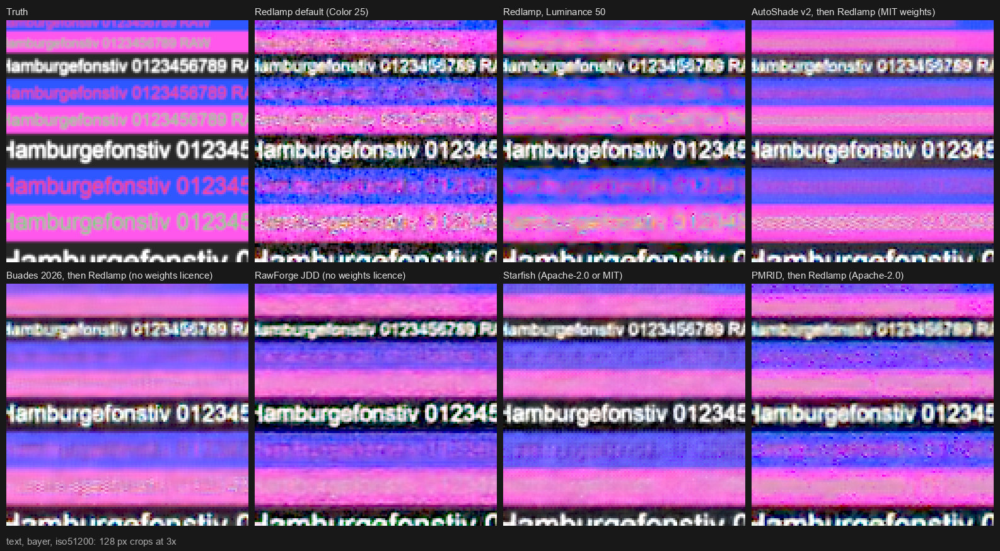
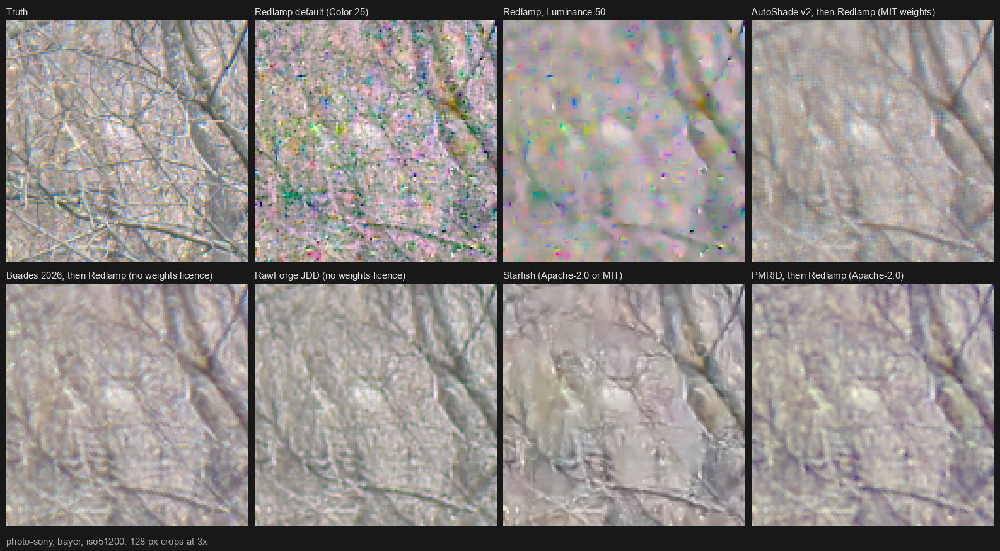
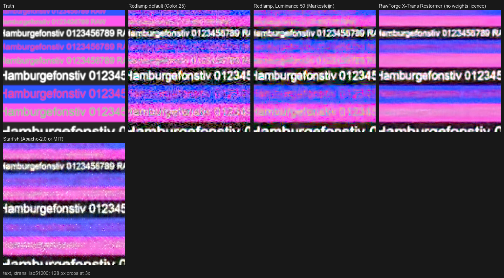

# DN-17: Open raw denoisers, measured before Redlamp trains its own

**Date:** 1 November 2026. **Tracker:** DN-17 ([#518](https://github.com/pdcgomes/redlamp/issues/518)), for DEC-108. **Conventions:** [_conventions.md](_conventions.md): "Evidence" is sourced, "Assessment" is our judgement.
**Builds on** [DN-11](DN-11-lightroom-raw-denoise.md) (its harness, scenes and scores), [the RawRefinery study](../rawrefinery-findings.md) (RawForge's models) and [A-denoise](A-denoise.md), and links to them rather than repeating them.
**Measurements:** [research/prototypes/raw_denoise](../../../research/prototypes/raw_denoise/README.md); per-case numbers in [research/benchmarks/results/denoise-open-models-2026-11-01.json](../../../research/benchmarks/results/denoise-open-models-2026-11-01.json); the benchmark set in [research/benchmarks/denoise.json](../../../research/benchmarks/denoise.json). Nothing downloaded is committed. Letters to the authors whose weights carry no licence: [DN-17-licence-requests.md](DN-17-licence-requests.md).

## 0. Summary

- **Which open model Redlamp could ship.** Only one candidate's weights carry a licence that allows redistribution and also measure well: **AutoShade's raw denoiser v2** (MIT: its repository's licence, and the card and LICENSE of the Hugging Face copy its code downloads). It denoises Bayer mosaics only, before Redlamp's own demosaic, and was fine-tuned on RawNIND, which is CC BY-SA 4.0, so shipping it needs DEC-03 settled: its verdict is **Problematic**. The two models that measure as well or slightly better, **Buades 2026** and **RawForge's joint model**, have no licence on their weights (**Not allowed** until the authors state one). **Starfish**, released on 13 October under Apache-2.0 or MIT, is the only permissively licensed model for X-Trans, but it was trained on DIV2K, which is for academic research only (**Problematic**), and at high noise it paints over fine structure. **PMRID** (Apache-2.0 throughout) is the weakest learned model and tints deep shadows.
- **How much better than Redlamp** (Redlamp `main` at 30810115e, process 20):
  - **Real noise, 7 RawNIND Bayer scenes that neither AutoShade nor Buades trained on, at each scene's highest ISO (3200 to 64000):** Redlamp's best setting (Luminance 50) scores 30.96 dB; Buades 2026 34.84, AutoShade v2 34.47, RawForge's joint model 34.31 (it trained on these scenes), Starfish 33.54, PMRID 31.76. Redlamp's default (Color 25 only) scores 26.99.
  - **Synthetic Bayer photos at the highest noise (51200-like):** Luminance 50 29.75 dB; Buades 33.04, AutoShade 32.50, Starfish 32.35, RawForge 32.03, PMRID 31.50.
  - **Fine text:** AutoShade reads text best of every method at the two higher noise levels (29.5 dB against Luminance 50's 27.4 at the highest) and is the only learned model that keeps some of the low-contrast coloured text; all the others erase it. None was seen to invent text or lines; Starfish invents smooth patches with crisp outlines on a busy photo.
  - **Edges:** RawForge's joint model keeps the lens's edge (MTF50 0.344 against the truth's 0.347); AutoShade and Buades soften it (0.281, 0.284), below Redlamp (0.315).
  - **X-Trans:** on 5 real X-Trans scenes at ISO 6400, Starfish scores 38.42 dB, RawForge's X-Trans Restormer 37.98, Redlamp's Markesteijn with Luminance 50 36.74.
- **Float16 and speed.** AutoShade matches float32 in float16 on Apple's GPU (79 to 83 dB) and on the Neural Engine through Core ML (67 to 69 dB) at 256, 512 and 768-pixel tiles, with no non-finite values; a 24 MP photo took 8 to 9 s on the GPU under load. RawForge's joint model returns NaN for every pixel in float16 at 768-pixel tiles at all three noise levels, and matches float32 at 256 and 512. Buades 2026's sampling kernel exists only for the CPU and CUDA; in float16 on the CPU it drifts from float32 as tiles grow (61, 55 and 51 dB at 256, 512 and 768 pixels), and a 24 MP photo took 285 s on the CPU.
- **Recommendation for DEC-108 (§8):** train Redlamp's own joint network (DEC-36) as the AI Denoise Redlamp keeps, and decide on AutoShade v2 as an opt-in first version for Bayer only once counsel has answered DEC-03 for it. Fine-tuning an open model doesn't escape its training data's terms, so it isn't a licensing route. If counsel can't answer before 0.4.0, 0.4.0 ships no learned model.
- **Only the owner or counsel can:** answer DEC-03 for a third party's model trained on RawNIND (§6.2); decide whether a 130 MB third-party model may be offered as a download; send the two letters ([DN-17-licence-requests.md](DN-17-licence-requests.md)); and do the Lightroom bench task `dn17-lightroom-denoise-2026-11-01` (§10).

## 1. Method

Everything ran on the M1 Ultra on 1 November 2026 while two other agents were building and using the GPU (load averages of 36 to 75, recorded with each timing), so times are indications only.

- **Synthetic scenes** (DN-11 §5.1, made again by `make_testset.py`): five charts (slanted edge, Siemens star, zone plate, dead leaves, text with flat and dark patches) and four binned crops of CC0 base-ISO fixtures (Sony A7 III, Nikon Z 6, Canon EOS R6, Fujifilm X-T3), mosaicked through Bayer and X-Trans, with exact Poisson–Gaussian noise at three levels labelled ISO 3200-, 12800- and 51200-like. Photo scores are the mean of the four crops and dead leaves.
- **Real noise:** 11 RawNIND Bayer scenes (Canon 6D, 7D and M100, Sony A7C, Panasonic GH1; ISO 1600 to 64000) and 5 X-Trans scenes (Fujifilm X-T1, ISO 1600 to 6400), each against its tripod clean frame (`fetch_rawnind.py`, `real_pairs.py`; DN-11's subset plus four scenes added for DN-17). The noisy frame's exposure is matched per colour, its noise profile fitted from the difference, and a 768 px window scored at full resolution against the clean frame through Redlamp's demosaic, and binned to full colour.
- **Held-out scenes.** RawNIND's own split marks 10 Bayer scenes as `test_reserve` and the 11 Canon M100 scenes as `unknown_sensor` (the flags in `dataset.yaml`, read from the Dataverse on 1 November). AutoShade's training uses exactly that split: its validation set is "the dataset's own unknown_sensor + test_reserve scenes", and its synthetic half draws clean crops only from the training split (`scripts/prep_pairs.py`, `scripts/train_raw.py`). Buades 2026 trained on the clean frames of `TEST_TitusToys` and `TEST_boardgames_top` and about 96 other RawNIND scenes (DN-11's evidence, from the release's `datasets.tar.gz`). RawForge's models trained on a random 80% of every RawNIND pair, its test scenes included (`bad_image_csv.csv` and `random_split` in Restorer's `JDD` branch). PMRID (SID) and Starfish (DIV2K) trained on none. Seven Bayer scenes are held out for both AutoShade and Buades: `TEST_MuseeL-vases-A7C`, `TEST_MuseeL-bluebirds-A7C`, `TEST_Vaxt-i-trad`, `TEST_7D-2`, `TEST_Pen-pile`, `UNK_TEST_LucieB_board` and `UNK_LucieB_bedroom_tapestry`. No RawNIND scene is held out for RawForge.
- **Redlamp** renders through `SessionBuilder` and `DetailStage` in a worktree of `main` at 30810115e (process 20; Menon with the dual blend on Bayer, CAM-07's Markesteijn on X-Trans), with the noise model given exactly (synthetic) or as fitted (real), at its default (Color 25) and its best setting from DN-11 (Luminance 50 with Color 25).
- **The models**, each with its own input conventions:
  - **AutoShade v2** (`models/autoshade_raw.py`, adapted from its sidecar with attribution): the four colour planes, a generalised Anscombe transform per plane, its noise field, one affine into [0, 1], DRUNet on the triplets (R, G1, B) and (R, G2, B), the exact unbiased inverse; then Redlamp's demosaic with no noise reduction. It is told the noise model, as Buades is, rather than measuring it blind: on 768 px crops of detailed scenes the sidecar's own estimator refuses (too few flat blocks) or reads the noise up to twice too high. Two variants: as the sidecar runs it, and without its noise field.
  - **Buades 2026** and **PMRID** as in DN-11 (`run_models.py`), then Redlamp's demosaic.
  - **RawForge's joint model (JDD)** and **X-Trans models** as in the RawRefinery study (`run_rawrefinery.py`), with the inputs RawForge gives them; the X-Trans models follow LibRaw's Markesteijn.
  - **Starfish** (`run_models.py`): its Bayer or X-Trans network on the white-balanced mosaic and its noise sigma per photosite, from the given noise model.
- **Scores** (`score.py`): DN-11's colour PSNR in a square-root encoding, texture kept, slanted-edge MTF50, zone-plate false colour, flat-patch noise and the dark patch's colour cast, plus a **fine-text panel** for DN-17: colour PSNR over the text alone, the share of its fine detail kept, and the fine detail in the result that the truth doesn't have ("spurious": residual noise, artefacts and anything invented), relative to the truth's.
- **Float16 and timing** (`fp16_timing.py`): the CC0 Sony A7 III (24 MP) and Fujifilm X-T3 (26 MP) fixtures exposed as the synthetic photos are, with the three noise levels; float16 against float32 on 256, 512 and 768 px windows (MPS; the CPU for Buades); AutoShade converted with coremltools 9.0 and run on the Neural Engine; a whole 24 MP photo per model, one model per process.

## 2. The candidates

| Model | What it is | CFAs | Parameters | GFLOPs per megapixel | Training data | Weights licence |
| --- | --- | --- | --- | --- | --- | --- |
| AutoShade raw denoiser v2 (skymanbp/autoshade, 23 September 2026) | DRUNet-colour (KAIR/DPIR) on the mosaic's planes after a generalised Anscombe transform, with a noise field; raw to raw | Bayer only (X-Trans refused) | 32.6 M | 2,118 | DPIR's `drunet_color`, fine-tuned on RawNIND Bayer pairs (training split) and synthetic noise on the author's own low-ISO frames | MIT |
| Buades 2026 (MIA-UIB/nonlocal-matchfilter v1.0.0) | Learned non-local matching and filtering on the packed mosaic; raw to raw | Bayer | 15.3 M | 2,986 (convolutions only) | 460 clean raws from SID, ELD, SIDD, RawNIND and others, synthetic noise | None stated |
| RawForge JDD (rymuelle/RawForge, JDD_v1.0.0) | Restormer with a DiT bottleneck; joint demosaic and denoise | Bayer (fails on X-Trans) | 11.3 M | about 370 (RRF §4.5) | RawNIND | None stated |
| RawForge X-Trans TreeNet and Restormer (xtrans_v1.0.0) | Denoisers after LibRaw's Markesteijn | X-Trans | about 5 M and 26 M (from their 20 and 106 MB files) | about 4,700 for the Restormer (RRF §4.3) | RawNIND, its four research-only artwork scenes included | None stated |
| PMRID (MegEngine/PMRID) | Small UNet with the k-sigma transform; raw to raw | Bayer | 1.0 M | 7.5 | SID subset, a phone's noise | Apache-2.0 |
| Starfish (monkeypangit/starfish, 13 October 2026) | DemosaicNet-style joint demosaic and denoise, a phase-aware full-resolution head | Bayer and X-Trans | 0.16 M (Bayer), 1.2 M (X-Trans) | 82, 68 | DIV2K, 8-bit sRGB through a simulated sensor | Apache-2.0 or MIT (repository files) |

**AutoShade's X-Trans path.** Its raw sidecar refuses anything but a 2 × 2 Bayer pattern (`parse_pattern` in `python/denoise_raw.py`); for X-Trans, the Rust side "takes the developed-frame path instead" (`MosaicDenoise::NotApplicable` in `src/denoise.rs`), which is SCUNet on the developed, gamma-encoded frame (`python/denoise.py`), a different model with DIV2K in its lineage. AutoShade has no raw denoiser for X-Trans.

**Where AutoShade's weights live.** The card names `https://github.com/skymanbp/autoshade/releases/download/v1.5.2/autoshade-raw-denoise-v2.pth`, which returns 404: there is no v1.5.2 release. The file is an asset of release v1.6.0 (published 23 September 2026, GitHub's digest `sha256:ffafa40a…f9c4`, 130,590,559 bytes) and of the Hugging Face repository `Azng0/autoshade-mirror-autoshade-raw-denoise`, which the card calls "the project's own SECOND host" and which AutoShade's code tries first (`python/_mirror.py`). Both copies match the pin in `denoise_raw.py`. AutoShade's main branch (27 October) still ships v2; its v3 and v4 candidates were refused by its own acceptance tests (`docs/TECH_STACK.md`).

## 3. Synthetic scenes

### 3.1 Bayer

Photos and dead leaves (5 scenes), colour PSNR (dB) / texture kept:

| Method | 3200-like | 12800-like | 51200-like |
| --- | --- | --- | --- |
| Redlamp default (Color 25) | 34.81 / 0.89 | 30.98 / 0.85 | 25.79 / 0.80 |
| Redlamp, Luminance 50 | 35.69 / 0.74 | 33.22 / 0.57 | 29.75 / 0.36 |
| AutoShade v2 as its sidecar runs it, then Redlamp's demosaic | 36.86 / 0.75 | 34.90 / 0.59 | 32.50 / 0.43 |
| AutoShade v2 without its noise field | 36.82 / 0.78 | 34.91 / 0.63 | 32.53 / 0.45 |
| Buades 2026, then Redlamp's demosaic | 36.98 / 0.75 | **35.24** / 0.61 | **33.04** / 0.45 |
| PMRID, then Redlamp's demosaic | 36.40 / 0.72 | 34.51 / 0.59 | 31.50 / 0.42 |
| RawForge JDD | 35.85 / 0.80 | 34.36 / 0.69 | 32.03 / 0.55 |
| RawRefinery TreeNet (reference) | 36.40 / 0.75 | 34.32 / 0.64 | 31.52 / 0.51 |
| Starfish | **37.36** / 0.78 | 35.08 / 0.64 | 32.35 / 0.49 |

Charts at the 51200-like level (the truth's edge MTF50 is 0.347 cycles per pixel):

| Method | Edge MTF50 | Zone false colour | Text PSNR | Text detail kept | Text spurious detail | Flat luma noise | Flat chroma noise | Shadow cast |
| --- | --- | --- | --- | --- | --- | --- | --- | --- |
| Redlamp default (Color 25) | 0.316 | 0.0342 | 23.69 | 0.88 | 3.42 | 0.0407 | 0.0228 | 0.0039 |
| Redlamp, Luminance 50 | 0.315 | 0.0261 | 27.42 | 0.87 | 0.47 | 0.0100 | 0.0200 | 0.0018 |
| AutoShade v2 | 0.281 | 0.0111 | **29.53** | 0.80 | 0.36 | 0.0008 | 0.0008 | 0.0014 |
| AutoShade v2, no noise field | 0.281 | 0.0136 | 29.46 | 0.80 | 0.36 | 0.0008 | 0.0007 | 0.0014 |
| Buades 2026 | 0.284 | 0.0173 | 27.85 | 0.72 | 0.28 | 0.0008 | 0.0007 | 0.0016 |
| PMRID | 0.266 | 0.0057 | 27.87 | 0.64 | 0.41 | 0.0011 | 0.0015 | 0.0455 |
| RawForge JDD | **0.344** | **0.0036** | 27.12 | 0.86 | 0.41 | 0.0020 | 0.0016 | 0.0055 |
| Starfish | 0.312 | 0.0077 | 27.74 | 0.78 | 0.40 | 0.0047 | 0.0040 | 0.0029 |

At the 12800-like level the order is the same: AutoShade reads text at 30.58 dB (Luminance 50 29.84, PMRID 29.92, Starfish 29.39, Buades 28.91, RawForge 28.20), RawForge keeps the edge (0.346; Redlamp 0.362, Starfish 0.328, AutoShade 0.304, Buades 0.302), and AutoShade, Buades and PMRID leave about a tenth of Luminance 50's flat luma noise or less, RawForge and Starfish a quarter to two fifths of it.

**Assessment.**
- **The three strongest are within half a decibel of each other on photos.** Buades 2026 leads at the two higher levels; AutoShade is 0.3 to 0.5 dB behind it, Starfish 0.2 to 0.7 dB; all three are 2.6 to 3.3 dB above Luminance 50 at the highest level and keep more texture than it.
- **AutoShade is the best on text.** It reads the text panel 2.1 dB better than Luminance 50 and 1.7 dB better than Buades at the highest level, and in the contact sheet it is the only learned model that keeps some of the red-on-blue and green-on-magenta lines; Buades, RawForge, Starfish and PMRID erase them, as the RawRefinery study found for every learned model it measured. Redlamp keeps them, noisily.
- **Nothing reads as invented on the charts.** The learned models erase detail they can't separate from noise rather than drawing new detail; the "spurious detail" measure is below Luminance 50's for all of them. On the busy Sony crop (tree branches) Starfish is the exception: it smooths areas into flat patches with crisp, plausible outlines that the truth doesn't have. PMRID leaves blotches and a purple cast; AutoShade's result shows a faint regular texture on the branches.
- **The noise field doesn't matter here.** With the noise model right, AutoShade with and without its field score within 0.05 dB on photos; the field was built for noise models that are wrong. It reads texture as noise on the most detailed crop (the field reached its clamp of 2.0 on the Sony crop at the lowest level) without changing the mean.
- **Edges:** only RawForge's joint model keeps the lens's edge; the raw-to-raw models soften it below Redlamp's.
- **Deep shadows:** since DN-12, Redlamp's own cast at the highest level is small (0.0018, against 0.0235 in DN-11); AutoShade and Buades match it, RawForge's is three times larger, PMRID's twenty-five times.

### 3.2 X-Trans

Photos and dead leaves, colour PSNR (dB) / texture kept; Redlamp with CAM-07's Markesteijn:

| Method | 3200-like | 12800-like | 51200-like |
| --- | --- | --- | --- |
| Redlamp default (Color 25) | 34.53 / 0.89 | 30.14 / 0.88 | 24.48 / 0.89 |
| Redlamp, Luminance 50 | 36.05 / 0.74 | 33.14 / 0.58 | 29.03 / 0.41 |
| RawForge X-Trans TreeNet, after LibRaw's Markesteijn | 35.20 / 0.78 | 33.58 / 0.67 | 31.39 / 0.52 |
| RawForge X-Trans Restormer, after LibRaw's Markesteijn | 35.41 / 0.83 | 33.97 / 0.67 | 31.48 / 0.48 |
| RawForge JDD (trained without X-Trans) | 18.42 / 0.75 | 18.55 / 0.73 | 18.79 / 0.65 |
| Starfish | **36.85** / 0.77 | **34.85** / 0.62 | **32.32** / 0.50 |

Charts at the 51200-like level:

| Method | Edge MTF50 | Zone false colour | Text PSNR | Text detail kept | Flat chroma noise | Shadow cast |
| --- | --- | --- | --- | --- | --- | --- |
| Redlamp, Luminance 50 | 0.322 | 0.0393 | 27.47 | 0.83 | 0.0281 | 0.0069 |
| RawForge X-Trans Restormer | 0.300 | 0.0086 | 26.04 | 0.76 | 0.0016 | 0.0098 |
| RawForge X-Trans TreeNet | 0.269 | 0.0214 | 24.06 | 0.61 | 0.0029 | 0.0145 |
| Starfish | 0.258 | 0.0064 | **27.58** | 0.75 | 0.0033 | 0.0026 |

**Assessment.** Starfish, a 1.2-million-parameter network, is the best X-Trans method on photos at every level (0.8 to 3.3 dB above Luminance 50) and the only open joint X-Trans model. On text it is level with Luminance 50 only at the highest level; below it, Redlamp's Markesteijn reads text 2 to 3.7 dB better, because Starfish's demosaic is weaker on saturated detail (on noise-free mosaics it scores 29.3 dB on the text panel against Markesteijn's 34.2) and its edge falls to 0.258 at the highest level.

### 3.3 Noise-free mosaics

| Demosaic | Photo colour PSNR | Texture | Edge MTF50 | Zone false colour | Text PSNR |
| --- | --- | --- | --- | --- | --- |
| Bayer: Redlamp (Menon, dual blend) | 38.74 | 0.88 | 0.353 | 0.0072 | 31.86 |
| Bayer: Starfish | 40.32 | 0.94 | 0.345 | 0.0047 | 30.20 |
| X-Trans: Redlamp (Markesteijn) | 39.91 | 0.90 | 0.345 | 0.0117 | 34.24 |
| X-Trans: Starfish | 39.14 | 0.96 | 0.350 | 0.0068 | 29.33 |

Starfish's learned demosaic beats Menon on Bayer photos by 1.6 dB with less false colour, as DN-11 found for demosaicnet (+4.5 dB), but loses on coloured text; on X-Trans it trails CAM-07's Markesteijn. The raw-to-raw models (AutoShade, Buades, PMRID) leave the demosaic to Redlamp.

## 4. Real noise: RawNIND

Colour PSNR (dB) at full resolution / binned to full colour, and texture kept:

| Method | Bayer, 7 held-out scenes, highest ISO | Lower ISO | Bayer, all 11, highest ISO | X-Trans, 5 scenes, ISO 6400 | Lower ISO (1600 to 5000) |
| --- | --- | --- | --- | --- | --- |
| Redlamp default (Color 25) | 26.99 / 29.79, 0.48 | 32.00 / 33.81, 0.58 | 26.91 / 29.71 | 33.55 / 37.11, 0.74 | 36.83 / 38.76 |
| Redlamp, Luminance 50 | 30.96 / 31.31, 0.19 | 34.79 / 34.54, 0.33 | 31.04 / 31.41 | 36.74 / 37.86, 0.38 | 38.56 / 39.07 |
| AutoShade v2 | 34.47 / 33.93, 0.29 | 37.16 / 35.88, 0.45 | 34.32 / 33.90 | | |
| AutoShade v2, no noise field | 34.45 / 33.91, 0.29 | 37.16 / 35.88, 0.44 | 34.33 / 33.91 | | |
| Buades 2026 | **34.84 / 34.04**, 0.27 | **37.34 / 35.89**, 0.42 | 34.64 / 33.97 | | |
| PMRID | 31.76 / 31.44, 0.25 | 35.78 / 34.84, 0.37 | 31.85 / 31.55 | | |
| RawForge JDD (trained on these scenes) | 34.31 / 33.73, 0.35 | 36.48 / 35.47, 0.50 | 34.21 / 33.74 | 19.16 / 22.90 | |
| RawRefinery TreeNet (trained on these scenes) | 33.82 / 33.77, 0.47 | 35.30 / 35.19, 0.66 | 34.10 / 34.01 | | |
| RawForge X-Trans TreeNet (trained on these scenes) | | | | 37.73 / 38.22, 0.49 | 38.50 / 38.72 |
| RawForge X-Trans Restormer (trained on these scenes) | | | | 37.98 / 38.04, 0.49 | 38.61 / 38.65 |
| Starfish | 33.54 / 33.29, 0.29 | 36.33 / 35.62, 0.45 | 33.49 / 33.28 | **38.42 / 38.97**, 0.43 | **39.44 / 39.62** |

Per scene at its highest ISO (full resolution, dB):

| Scene (camera, ISO) | Trained on by | Luminance 50 | AutoShade | Buades | RawForge JDD | Starfish |
| --- | --- | --- | --- | --- | --- | --- |
| TEST_MuseeL-vases-A7C (Sony A7C, 64000) | RawForge | 28.80 | 33.65 | 33.86 | 32.92 | 32.07 |
| TEST_MuseeL-bluebirds-A7C (Sony A7C, 64000) | RawForge | 27.31 | 30.59 | 30.81 | 29.56 | 30.10 |
| TEST_Vaxt-i-trad (Canon 6D, 51200) | RawForge | 31.56 | 32.85 | 33.32 | 33.01 | 32.69 |
| TEST_7D-2 (Canon 7D, 12800) | RawForge | 33.95 | 39.63 | 39.39 | 38.44 | 37.27 |
| TEST_Pen-pile (Panasonic GH1, 3200) | RawForge | 37.54 | 38.80 | 39.68 | 39.30 | 38.98 |
| UNK_TEST_LucieB_board (Canon M100, 25600) | RawForge | 28.74 | 32.03 | 32.67 | 32.62 | 31.40 |
| UNK_LucieB_bedroom_tapestry (Canon M100, 25600) | RawForge | 28.82 | 33.71 | 34.13 | 34.34 | 32.26 |
| TEST_TitusToys (Sony A7C, 51200) | Buades, RawForge | 30.60 | 34.59 | 35.01 | 35.14 | 33.94 |
| Kortlek (Canon 6D, 51200) | AutoShade, RawForge (Buades unknown) | 30.60 | 31.57 | 31.36 | 31.99 | 30.89 |
| Spydercheckr (Canon 6D, 51200) | AutoShade, RawForge (Buades unknown) | 33.66 | 37.98 | 38.12 | 36.94 | 36.89 |
| bark_beetled_log (Sony A7C, 51200) | AutoShade, RawForge (Buades unknown) | 29.84 | 32.07 | 32.73 | 32.02 | 31.89 |

**Assessment.** Real noise confirms the synthetic ranking. On scenes neither trained on, Buades 2026 is 3.9 dB above Luminance 50 at the highest ISO and AutoShade 3.5 dB, 0.4 dB apart (0.1 dB binned); RawForge's joint model, which trained on these scenes, is level with AutoShade; Starfish, trained only on DIV2K's 8-bit photographs, is 2.6 dB above Luminance 50. On the three scenes AutoShade trained on, it trails Buades by 0.2 dB on average, against 0.4 dB on the held-out ones, so its training overlap flatters it by about 0.2 dB at most (Buades may have trained on those three too). On X-Trans at ISO 6400, Starfish, which never saw RawNIND, and RawForge's X-Trans models, which trained on these scenes, beat Luminance 50 by 1.0 to 1.7 dB, less than the learned models gain on Bayer at higher ISOs.

## 5. Float16, the Neural Engine, and a 24 MP photo

### 5.1 Float16 against float32

Agreement of float16 with float32 (PSNR of the difference, dB; "NaN" is every pixel non-finite), on windows of the CC0 Sony (and, for Starfish's X-Trans network, Fujifilm) fixture at each noise level:

| Model and where it ran | 256 px | 512 px | 768 px |
| --- | --- | --- | --- |
| AutoShade v2, Apple GPU (MPS), network and input in float16 | 79.3 to 81.9 | 80.5 to 82.8 | 81.0 to 83.2 |
| AutoShade v2, Core ML, Neural Engine, float16 | 66.6 to 68.3 | 66.7 to 68.5 | 66.7 to 68.6 |
| AutoShade v2, Core ML, GPU, float16 | 79.4 to 81.7 | 80.4 to 82.6 | 80.9 to 83.0 |
| RawForge JDD, Apple GPU, autocast to float16 (as RawForge runs) | 83.6 to 85.1 | 82.3 to 83.3 | **NaN at all three levels** |
| Starfish, Bayer, Apple GPU, autocast | 79.9 to 80.1 | 78.6 to 78.7 | 78.8 to 78.9 |
| Starfish, X-Trans, Apple GPU, autocast (252, 510, 768 px) | 84.7 to 85.7 | 79.2 to 79.7 | 76.1 to 76.6 |
| Buades 2026, CPU, network and input in float16 (3200-like level only) | 61.3 | 55.1 | 51.1 |

**Assessment.**
- **AutoShade is safe in float16 everywhere it would run.** DRUNet is convolutions, ReLUs and strided and transposed convolutions without biases, and it has no normalisation or attention to overflow. The Neural Engine's result is 14 dB further from float32 than the GPU's (largest difference 0.007 in the network's [0, 1] range, between an eighth and a half of the noise sigma it is told), still far below the differences between methods.
- **RawForge's joint model fails at 768-pixel tiles at every noise level** (the RawRefinery study found it at 384 and 768 px too), from its channel attention's matrix product (RRF §4.5). It would have to run at 512-pixel tiles or with its attention in float32, and be checked at each size.
- **Buades 2026 can't run on Apple's GPU or Neural Engine as published**: `deform-neighbourhood-sampling` has CPU and CUDA kernels only. On the CPU its float16 output drifts from float32 by up to 0.048 of full scale at 768 px, growing with the tile, so it would need its matching in float32 as well as a Metal port. The 12800- and 51200-like levels weren't run: float16 on the CPU took about seven minutes per tile.
- Core ML's CPU-only float32 conversion of AutoShade matched PyTorch exactly at 256 px but differed by up to 0.31 at 512 and 768 px; the GPU and Neural Engine conversions matched. This wasn't investigated; the CPU path isn't where it would run.

### 5.2 A 24 MP photo

The CC0 Sony A7 III fixture (24.2 MP) with 12800-like noise, one model per process:

| Model | Where | Time | Peak memory (process / GPU) | Load average |
| --- | --- | --- | --- | --- |
| AutoShade v2, the whole sidecar (planes, transform, field, network, inverse) | Apple GPU, float32 | 9.4 s | 1.9 GB / 1.2 GB | 58 to 62 |
| AutoShade v2 | Apple GPU, float16 | 8.3 s | 2.0 GB / 1.2 GB | 58 to 62 |
| AutoShade v2, the network alone (30 tiles of 768 px for two triplets) | Neural Engine, Core ML float16 | about 7.9 s (0.264 s per tile) | not measured | 44 to 54 |
| AutoShade v2, the network alone | GPU, Core ML float16 | about 5.2 s (0.17 s per tile) | not measured | 44 to 54 |
| Starfish (1,056 px windows) | Apple GPU, float32 / float16 | 2.6 s / 2.8 s | 1.2 GB / 2.2 to 3.3 GB | 54 to 61 |
| RawForge JDD (768 px tiles) | Apple GPU, float32 | 139 s | 1.3 GB / 3.3 GB | 57 to 66 |
| RawForge JDD (512 px tiles) | Apple GPU, float16 | 207 s | 1.4 GB / 3.4 GB | 61 to 66 |
| Buades 2026 (1,024 px tiles) | CPU, float32 | 285 s | 8.2 GB | 62 to 67 |

**Assessment.** These are under load from two other agents' GPU work, so they are upper bounds. RawForge's joint model took 0.46 to 1.37 s per 768-pixel tile in a check at load 66, against 0.23 s in the RawRefinery study; its 139 s is mostly contention, and about 18 s is what the study's rate implies. AutoShade's network is heavy for its quality (2.1 TFLOPs per megapixel, six times RawForge's joint model and 26 times Starfish's), but a 24 MP photo in under ten seconds on an M1 Ultra is within what A-denoise §7 allows for a cached, background stage on a Mac; it is too heavy for the iPhone budget (DN-04) without a smaller network.

## 6. Licences

Read on 1 November 2026 from GitHub's licence API, each repository's LICENSE file and release notes, and the Hugging Face card and LICENSE; the verdicts are [open-model-findings](../open-model-findings.md)'s (Shippable, Problematic, Not allowed).

| Model | Code | Weights | Training data (terms) | DEC-03 | Verdict |
| --- | --- | --- | --- | --- | --- |
| AutoShade raw denoiser v2 | MIT (GitHub API: `MIT`; LICENSE "Copyright (c) 2026 skymanbp"); KAIR's architecture files MIT | MIT: card `license: mit` and "Licence: MIT for these weights and the architecture"; LICENSE beside the file; `denoise_raw.py`: "the weights are AutoShade's, released under the project's own licence" | RawNIND training split (CC BY-SA 4.0), the author's own low-ISO frames (terms not stated), started from DPIR's `drunet_color` (MIT; DPIR trained on Waterloo Exploration, DIV2K, Flickr2K and BSD, terms mixed, DIV2K research only) | **Touches it** | **Problematic**: commercial use and redistribution allowed, training data needs counsel (DEC-03) |
| Buades 2026 | MIT (GitHub API) | None stated: release v1.0.0's notes say only "Checkpoints for variations of the network" | SID and ELD (no data licence; ELD "for evaluation purposes only"), SIDD (MIT per its site), RawNIND (CC BY-SA 4.0), others | Touches it | **Not allowed** until the authors state a licence; then Problematic (data) |
| RawForge JDD and X-Trans models | MIT (GitHub API) | None stated (release notes describe the models only) | RawNIND, including four "fair-use / research purpose only" artwork scenes in the X-Trans set (all six artwork scenes are in its training list) | Touches it | **Not allowed** until the author states a licence; the X-Trans models then stay Problematic for the research-only scenes |
| PMRID | Apache-2.0 | Apache-2.0 (files in the repository) | SID subset (no terms) | No | **Problematic** (unclear data); measured weakest |
| Starfish | Apache-2.0 or MIT | The repository's licence (the weights are repository files, embedded in its app) | DIV2K: its own README says "DIV2K is provided for academic research; check its terms" | No | **Problematic**: research-only data in the lineage. DEC-24's rule (follow the weights' licence) would allow it |
| darktable's RawNIND models, `wilecoyote/raw_denoise` | GPL-3.0 | GPL-3.0 | RawNIND | | **Not allowed** (out of scope by the brief) |

### 6.1 DEC-24 and DEC-03

DEC-24 says follow the weights' licence, and never ship a model trained directly on Places2. By that rule AutoShade's MIT weights may be used, and none of the candidates involves Places2. DEC-03, still open for counsel, asks whether CC BY-SA training data may be used for a shipped model; DEC-108 says an open model trained on RawNIND needs it. It touches AutoShade, Buades and RawForge; it doesn't touch Starfish or PMRID.

### 6.2 What RawNIND's own files say about its scenes

RawNIND is deposited under CC BY-SA 4.0 as a whole (the Dataverse's licence field, version 1.0, 15 January 2025). Its `permissions.txt` lists 141 scenes with their own terms: 135 "CC0, by" their photographer, two artworks "published under CC-BY license with permission from author", and four artworks "fair-use / research purpose only". Scenes not listed take the dataset's licence. For AutoShade's training, this matters in two ways (Evidence: `dataset.yaml`, `permissions.txt`, read 1 November 2026):
- **Of the 175 Bayer scenes in AutoShade's training split, 32 are listed as CC0 and 143 aren't listed**, so they are CC BY-SA 4.0 only. AutoShade trained on Bayer scenes only, so none of the six artwork scenes listed (all X-Trans) is in its training.
- **Many of the unlisted scenes are photographs of museum objects** (`MuseeL-*-A7C`), among them `MuseeL-KoenraadTinel-JeuneFilleAVelo-A7C`, a work by a sculptor whose other scene RawNIND lists as CC BY "with permission from author". Whether the objects' own copyright reaches a model trained on their photographs is part of what counsel would answer.

**Assessment.** A model trained only on RawNIND's CC0-listed scenes plus Redlamp's own captures would leave DEC-03 out; no released model was trained that way.

## 7. Ranking

| Rank | Model | Quality (real held-out, synthetic, text, edge) | Licence | Platform fit |
| --- | --- | --- | --- | --- |
| 1 | AutoShade v2 | Second on real held-out noise (0.4 dB behind Buades), second on synthetic photos, first on text, soft edges | MIT weights; RawNIND (DEC-03) | Float16-safe on GPU and Neural Engine; 8 to 9 s per 24 MP; Bayer only |
| 2 | Buades 2026 | First on real and synthetic Bayer photos | No weights licence | CPU and CUDA only; float16 drifts |
| 3 | RawForge JDD | Level with AutoShade on real noise it trained on; sharpest edges; most texture | No weights licence | NaN in float16 at 768 px |
| 4 | Starfish | Third on real Bayer (2.6 dB above Luminance 50), first on X-Trans; invents structure at high noise; loses coloured text | Apache-2.0 or MIT; DIV2K (research only) | Tiny and fast; float16-safe |
| 5 | RawForge X-Trans models | 1.0 to 1.2 dB above Luminance 50 on real X-Trans they trained on | No weights licence | Restormer: 4.7 TFLOPs per megapixel |
| 6 | PMRID | 0.8 dB above Luminance 50 on real held-out noise; purple shadow cast | Apache-2.0; SID | Tiny |

Ranked by quality alone, Buades 2026 comes first; it ranks second here because it can neither be shipped nor run on Apple's accelerators as published.

## 8. Recommendation for DEC-108

**Train Redlamp's own network (DEC-36, DN-05 to DN-07) as AI Denoise's model, and treat AutoShade v2 as an optional first version for Bayer that depends on counsel; don't fine-tune an open model.**

Reasons:
1. **No open model is Shippable.** The one with an open weights licence and good results, AutoShade v2, carries RawNIND's CC BY-SA terms in its training (§6); the others either have no weights licence or research-only data. Every route through an open model passes DEC-03 or DIV2K's terms.
2. **Fine-tuning doesn't change that.** A model fine-tuned from AutoShade's, Starfish's or PMRID's weights still derives from their training data, so it inherits the same question while adding Redlamp's training cost. Its only advantage would be quality, and Redlamp's own network has the measured targets below without the lineage.
3. **No open model covers what AI Denoise needs.** AutoShade is Bayer only and raw to raw, so it delivers neither a learned demosaic (Raw Details, DEC-36) nor X-Trans; the only open X-Trans models are RawForge's (no licence) and Starfish (research-only data, invented structure).
4. **The measurements set the bar for Redlamp's own.** On DN-17's held-out real scenes a network should reach about 34.5 to 35 dB at the highest ISO (Luminance 50: 31.0), keep coloured text as AutoShade does, keep edges as RawForge's joint model does, hold in float16 at every tile size, and fit the compute of RawForge's (about 370 GFLOPs per megapixel) or less. Buades 2026 and RawForge reach AutoShade's quality at a sixth of its compute, so a network of 10 to 15 million parameters is enough (DN-07's sizing).
5. **AutoShade is a reasonable first version if counsel agrees.** It is within 0.4 dB of the best open model on real noise, 3.5 dB above Redlamp's best setting, best on text, float16-safe on the Neural Engine, runs in Redlamp's own pipeline (Redlamp's noise model, no noise field needed, Redlamp's demosaic after it), and takes 8 to 9 s for 24 MP on this Mac. Offered as an opt-in download with its MIT notice and credit, pinned by SHA-256, it would give 0.4.0 a learned denoiser for Bayer while Redlamp's own is trained.

What would need settling:
- **Counsel (DEC-03):** whether Redlamp may offer, as a download, a third party's MIT-licensed model trained on CC BY-SA 4.0 data (RawNIND's 143 unlisted Bayer scenes), and on what terms (attribution; whether ShareAlike reaches the weights); and whether photographs of museum objects in its training (§6.2) raise anything further.
- **The owner:** whether a 130 MB third-party model may be offered at all, and with what wording and credit; 0.4.0's scope if counsel's answer comes late (without it, 0.4.0 ships no learned model, and DN-13's classical clean-up of the mosaic is the interim gain); and DEC-12's budget for DN-05 to DN-07.
- **The authors' replies** to the letters: a licence on Buades 2026's or RawForge's weights would move them to Problematic (data), not to Shippable, and wouldn't change this recommendation; it would give Redlamp a second Bayer option and, for RawForge, an X-Trans one.

## 9. The fresh search (since 7 October 2026)

Searched on 1 November 2026: GitHub's repository search (raw denoising, Bayer, X-Trans, joint demosaicing, the AIM 2025 and NTIRE 2026 challenges), Hugging Face's model search, arXiv's API (titles and abstracts since September 2026), the AIM 2025 Real-World RAW Denoising report (arXiv 2510.06601) and NTIRE 2026's programme (cvlai.net/ntire/2026). Papers with Code now redirects to Hugging Face's paper pages, which the Hugging Face search covered.

| Found | Date | What it is | Code / weights licence | Measured? |
| --- | --- | --- | --- | --- |
| [monkeypangit/starfish](https://github.com/monkeypangit/starfish) | 11 to 13 October | Raw editor with a joint demosaic-and-denoise network, Bayer and X-Trans | Apache-2.0 or MIT; weights in the repository; DIV2K | Yes (Starfish above) |
| [sndstone/rawdenoise-lab](https://github.com/sndstone/rawdenoise-lab) | 30 October | Bayer raw denoiser for the Hasselblad X1D II, "private photographs and synthetic noise" | No licence | No (Not allowed) |
| [dllu/demosaic](https://github.com/dllu/demosaic) | 14 October | Joint Bayer demosaic and denoise with frozen DINOv3 features | MIT code; no weights released; DINOv3 under Meta's licence | No (nothing to run) |
| [Syerain/onnx-rawdenoise-nind](https://github.com/Syerain/onnx-rawdenoise-nind) | 25 October | darktable's RawNIND Bayer model optimised as ONNX | GPL-3.0 | No (out) |
| [foyer-labs/Image-Denoiser](https://github.com/foyer-labs/Image-Denoiser) | 10 October | Windows app wrapping DRUNet, SCUNet, Restormer and RawNIND | MIT code; others' weights | No (no new model) |
| [thomaschuwm/photo-demosaic-models](https://huggingface.co/thomaschuwm/photo-demosaic-models) | 5 October | ONNX copies of MMNet's noisy Bayer model (MIT; trained for Gaussian noise on MSR and other sets) and two GPL-3.0 students | MIT / GPL-3.0; "non-commercial project" | No (MSR is non-commercial; Gaussian noise only) |
| arXiv 2610.28191, RAW exposure correction and restoration | 20 October | Paper with a new paired RAW benchmark | No code found | No |
| AIM 2025 Real-World RAW Denoising | October 2025 | Organisers' baseline ([SonyResearch/AIM2025_Denoise_Challenge](https://github.com/SonyResearch/AIM2025_Denoise_Challenge), MIT, trains on SID); the report links no team's code or weights | MIT code; no weights | No |
| NTIRE 2026 | spring 2026 | No raw denoising challenge; raw challenges were RAW reconstruction from RGB on smartphones and burst low-light (Twilight Cowboy, arXiv 2608.09782; its one public team repository has no licence) | | No |
| [luxgrain/GALOSH](https://github.com/luxgrain/GALOSH) (before the window, July 2026) | 4 July | Blind, training-free denoising of raw Bayer images | Apache-2.0; no weights | No; a classical method worth a look for DN-13 |

## 10. The benchmark set and the Lightroom task (INF-14)

- **`research/benchmarks/denoise.json`** (119 cases; `benchmarks.py list` and `fetch --set denoise --synthetic` both pass): 54 synthetic cases (9 scenes, 2 CFAs, 3 levels) made by `make_benchmark.py` as DNG 1.4 CFA files with their clean mosaic and full-colour truth (Redlamp's CLI opens both CFAs: "768x768 Bayer RGGB", "768x768 X-Trans", as shot 6502 K); the 48 RawNIND files DN-17 scored (16 clean frames, 32 noisy; CC BY-SA 4.0, credited per scene, with which models trained on each); and 17 CC0 raws from raw.pixls.us at ISO 3200 to 20000 (Canon, Nikon, Sony, Panasonic and one Fujifilm X-Trans), each file's ISO read by Redlamp's CLI.
- **raw.pixls.us has few high-ISO files.** Of its 1,129 CC0 files from these makes (CR3 and reduced-size files left out, and Fujifilm's Bayer bodies), the EXIF page of 1,027 was read, one at a time with a pause (all but 102 Canon and Nikon files, left once five models of each had been found). 23 are at ISO 3200 or higher: none of Olympus' 66 or OM System's 32, one of Fujifilm's 65 X-Trans files, 3 of Sony's 170, 6 of Panasonic's 363. One file per camera model was kept, and a 2.6 MB crop left out, for 17. The set's real X-Trans noise therefore comes mostly from RawNIND's X-T1 scenes.
- **The Lightroom task:** `dn17-lightroom-denoise-2026-11-01`, made from `research/benchmarks/bench/denoise.json` (20 assets: 13 synthetic DNGs, 7 CC0 raws). Fourteen photos get Denoise at Lightroom's default Amount; six noise-free references get nothing, so Lightroom's Denoise can be scored against Lightroom's own render of the truth. It needs the owner in Lightroom on a Mac or an iPad.
- **Results:** per case, method and model version in [denoise-open-models-2026-11-01.json](../../../research/benchmarks/results/denoise-open-models-2026-11-01.json) (736 rows).

## 11. Caveats and what wasn't verified

- All times were taken under load from other agents; none is a performance figure, and RawForge's in particular is dominated by GPU contention (§5.2). A repeat on a quiet machine is needed before any of them goes into a plan.
- The models were given the noise model (Redlamp's own, exact or fitted); a blind estimate adds error to every model and to Redlamp alike. AutoShade's own blind estimator wasn't scored: on the harness's 768 px crops it refused most detailed scenes.
- Binned photo truth and RawNIND pairs carry the limits DN-11 §5.7 lists; RawNIND's clean frames are base-ISO raws, not noise-free.
- Training overlap: Buades 2026's list of RawNIND scenes isn't published by name beyond the two found in its release; three scenes count as "trained on" for AutoShade and RawForge, and "unknown" for Buades.
- The Neural Engine was checked for AutoShade only. RawForge's joint model wasn't converted to Core ML (it is a CUDA-traced TorchScript archive), and Buades 2026 can't be without its kernel.
- Whether Lightroom opens the benchmark's synthetic DNGs is for the bench task to show; Redlamp and LibRaw open them.
- Licences are as read on 1 November 2026; the weights' authors may add one (§8).

## 12. Verification log

- **AutoShade:** `https://huggingface.co/api/models/Azng0/autoshade-mirror-autoshade-raw-denoise` (`cardData.license: mit`, created 22 September 2026), the card and LICENSE; GitHub's licence API and LICENSE for skymanbp/autoshade (MIT); its releases API (v2's asset on v1.6.0, digest `sha256:ffafa40a…`; no v1.5.2); `python/denoise_raw.py`, `python/denoise.py`, `scripts/train_raw.py`, `scripts/prep_pairs.py`, `scripts/fetch_rawnind.py`, `src/denoise.rs` and `docs/TECH_STACK.md` at commit 8f25a8a (27 October 2026). The weights' SHA-256 and size checked after download.
- **KAIR:** GitHub licence API (MIT); `network_unet.py` and `basicblock.py` at the commits AutoShade pins, checked against its SHA-256 pins.
- **Buades 2026:** GitHub licence API (MIT) and release v1.0.0's notes and assets (`rawnoise_25_15_9nbr.ckpt`, digest `sha256:b31bc8e2…`, checked after download); `deform-neighbourhood-sampling`'s kernels (CPU and CUDA only).
- **RawForge and RawRefinery:** GitHub licence API (MIT) and releases (no new release since 5 July 2026); the eleven model files checked against the author's RSA-PSS signatures; Restorer's `JDD` branch `bad_image_csv.csv`.
- **PMRID:** GitHub licence API (Apache-2.0).
- **Starfish:** GitHub API (Apache-2.0; the README's dual licence), release v0.1.0 (13 October), `training/` files at b43b610 and `training/data/README.md` (DIV2K).
- **RawNIND:** the Dataverse API for doi:10.14428/DVN/DEQCIM (licence CC BY-SA 4.0, version 1.0); `dataset.yaml` and `permissions.txt`.
- **DPIR's training data:** the DPIR paper (Zhang et al., arXiv 2008.13751v2, §III): "400 BSD images, 4,744 images of Waterloo Exploration Database, 900 images from DIV2K dataset, and 2,750 images from Flick2K dataset".
- **The search:** GitHub search API, Hugging Face model API, arXiv API, arXiv 2510.06601's HTML, cvlai.net/ntire/2026, raw.pixls.us's repository list and EXIF pages (1,027 read, one at a time with a pause).
